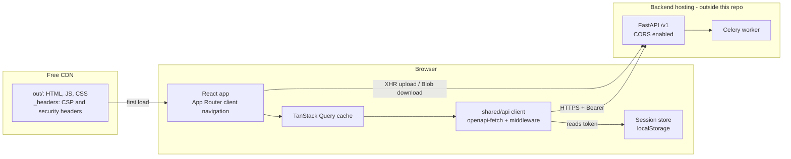
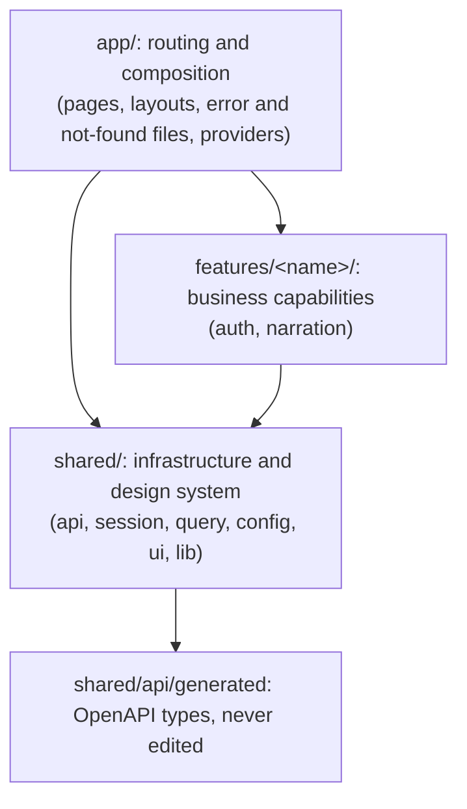
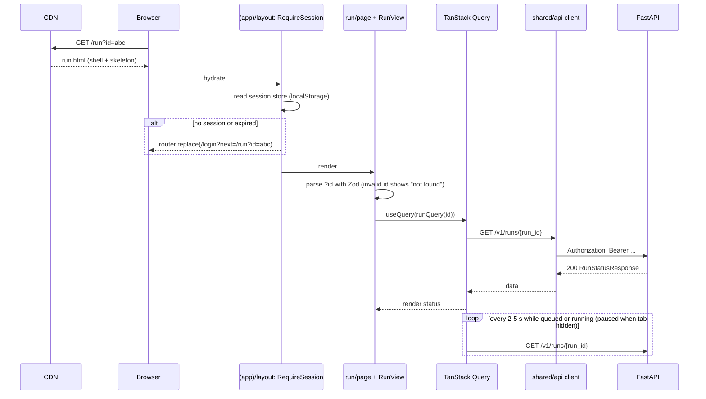
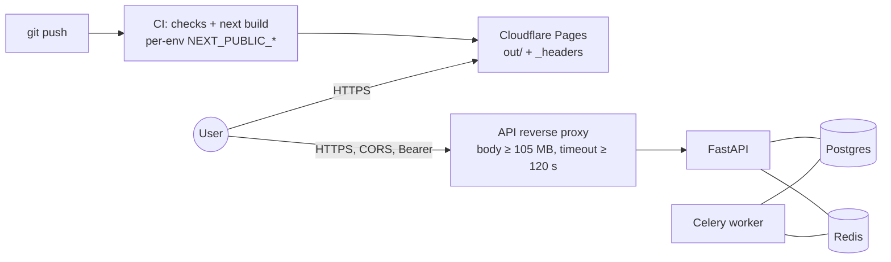

# 3. Architecture

## 3.1 Architectural style

The frontend is a **client-rendered, feature-oriented modular monolith**, built with the Next.js App Router as a **static export** and served from a CDN. It talks directly to the FastAPI REST API.

- **Static shell, client data.**
  - `next build` prerenders one HTML file per route. These files contain the layout, navigation, and loading skeletons.
  - After hydration, everything that depends on the user is fetched in the browser: the session, runs, and downloads.
  - Pages and layouts stay Server Components. In a static export they run only during `next build`, and they render the shell: headings, navigation, and skeletons. That markup is in the HTML file, and the component code is not sent to the browser. They do not read the session or call the API. Anything that does is a Client Component. `metadata` can only be exported from a Server Component, so the root layout stays one.
- **Direct API integration.** The browser calls `https://<api>/v1/...` over CORS and sends the Bearer token. No server of ours sits in between.
- **Feature-oriented modules.**
  - Code is grouped by business capability (`auth`, `narration`), mirroring the backend's domain packages.
  - `app/` only maps URLs to feature components.
  - `shared/` holds infrastructure.

## 3.2 Module boundaries and dependency direction

Imports may only point downward, from `app/` to `features/` to `shared/`:

| Layer | Owns | May import | Must not import |
|---|---|---|---|
| `app/` | URL structure, layouts, route guards in layouts, `error` and `not-found` UI, provider setup | `features/*`, `shared/*` | — |
| `features/<x>/` | The feature's components, query and mutation hooks, Zod schemas, and pure domain logic | `shared/*`, its own files | `app/`, **other features** |
| `shared/` | API client, error model, session store, `QueryClient` factory, config, UI primitives, utilities | `shared/*`, generated types, npm packages | `app/`, `features/*` |
| `shared/api/generated/` | `openapi-typescript` output | nothing | (never edited by hand) |

Rules:

1. **Features never import each other.** Anything two features need moves to `shared/`.
   - For example, both the API client and the auth feature need the session, so the session lives in `shared/session`.
   - A page that combines features does so in `app/`.
2. **No browser APIs at module scope or during render.**
   - Build-time prerendering runs components in Node, where `window`, `sessionStorage`, and `document` do not exist.
   - Browser APIs belong in effects, event handlers, and `useSyncExternalStore` subscriptions, whose server snapshot returns `null`.
   - Breaking this rule shows up as a build crash or a hydration mismatch.
3. **`'use client'` sits at the smallest useful level.**
   - Pages are thin Server Components that render static structure plus feature client components.
   - Providers (`QueryClientProvider`) are one client component in the root layout.
4. **No barrel files (`index.ts`).** Import concrete files. This keeps tree-shaking predictable and lets the lint rules see the real paths.
5. **ESLint enforces these boundaries** with `import/no-restricted-paths` zones (see section 6).

### What lives inside a feature

| File / folder | Responsibility |
|---|---|
| `api.ts` | TanStack Query `queryOptions` factories and mutation hooks for this feature's endpoints. This is the only place in the feature that calls the API client. Every OpenAPI path is written once here, because `openapi-fetch` types a call only when the path is a string literal. A screen calls the factory, for example `useQuery(runQuery(id))`, and does not repeat `client.GET("/v1/runs/{run_id}", …)`. |
| `transport/*.ts` | Calls the typed client cannot make: XHR upload with progress, and Blob download. Each returns typed results or throws `ApiError`. |
| `schemas.ts` | Zod schemas for forms and URL params, with inferred types. |
| `domain.ts` | Pure functions and constants such as `STEP_ORDER`, `isTerminal()`, step labels, voices, and models. No I/O. |
| `errors.ts` | Maps HTTP status codes to user-facing messages for this feature's endpoints. |
| `hooks/*.ts` | Client hooks that are not about data access, such as `useObjectUrl` for cleaning up Blob URLs. |
| `components/*.tsx` | UI. Components call hooks from `api.ts` and never call the client directly. |

## 3.3 Data flow

### Reads: the run page

### Writes: forms and mutations

1. React Hook Form validates the input against the form's Zod schema and blocks submission if it is invalid. Focus moves to the first invalid field.
2. `onSubmit` calls `mutation.mutate(values)`. The mutation hook is defined in the feature's `api.ts`.
3. When the mutation succeeds, the code does one of the following:
   - writes the result into the cache with `setQueryData`, for example seeding the new run so its page renders immediately,
   - or calls `invalidateQueries`,
   - and then calls `router.push()` to navigate.
4. When the API returns an expected error, `onError` maps it as follows:
   - 422 field errors go to `form.setError(field, …)`.
   - Every other expected error becomes a form-level `Alert` with the message from the feature's `errors.ts`.
5. A 401 is handled globally (see 3.4), so features never deal with it.

### Polling

- `refetchInterval` returns 2 s for the first 30 s of a run and 5 s after that.
- It returns `false` once the status is `succeeded` or `failed`, which stops polling.
- TanStack Query pauses the interval while the tab is hidden and refetches when the window regains focus.
- A visually hidden `aria-live="polite"` region announces changes to the current step.

## 3.4 Authentication and session

| Aspect | Design |
|---|---|
| Storage | The `localStorage` key `dn.session` holds `{token}`. The store is a module with `get`, `set`, `clear`, and `subscribe`, which React reads through `useSession()` (`useSyncExternalStore`). |
| Cross-tab | The store listens for the `storage` event. When another tab logs in, logs out, or hits a 401, this tab updates too and redirects if it needs to. |
| Claims | `decodeJwt(token)` is parsed with a Zod schema `{sub, email, exp}`. If the token is malformed or `exp` has passed, the store clears the session. |
| Login | A React Hook Form form calls a mutation that POSTs form-urlencoded data to `/v1/auth/login`. On success it calls `session.set(token)`, clears the query cache, and runs `router.replace(safeNext ?? '/videos/new')`. |
| Signup | A mutation POSTs to `/v1/auth/signup`. On `201` it logs in with the same credentials. A `409` becomes a field error on email. |
| Logout | `session.clear()`, then `queryClient.clear()`, then `router.replace('/login')`. **Limitation:** the token stays valid on the server until `exp`, because the backend has no revocation endpoint. |
| Expiry | The store sets a timer for `exp`, and when it fires the session ends the same way it does on a 401. |
| 401 anywhere | The client's response middleware calls `session.clear()`. A session listener in the root provider redirects to `/login?reason=expired&next=<current>`. The login page shows "Your session expired." |
| Route guard | `(app)/layout.tsx` renders `<RequireSession>`. Until the store has hydrated it shows the shell skeleton, so protected content never flashes. Without a session it calls `router.replace('/login?next=…')`. `(public)/layout.tsx` sends signed-in users to the app. **Guards only affect UX. FastAPI enforces authorization on every request.** |
| `next` param | `safeRedirect()` accepts only same-origin relative paths, which prevents open redirects. |
| CSRF | There are no cookies, so classic CSRF does not apply. The Bearer header is attached only by our own code. |
| XSS hardening | Strict CSP in `_headers`, no third-party scripts, no `dangerouslySetInnerHTML`, and the backend's `error` strings rendered as plain text. |

## 3.5 API integration layer (`shared/api`)

- **Client.** `apiClient = createClient<paths>({ baseUrl: env.apiBaseUrl })` with these middlewares:
  1. **auth** adds `Authorization: Bearer` when a session exists.
  2. **request-id** adds an `X-Request-ID` header (a UUID) so a browser error can be matched to backend logs.
  3. **errors** turns any non-2xx response into an `ApiError` and clears the session on 401.
- **`ApiError`** has these fields:
  - `status`: the HTTP status, or `0` for a network failure or timeout
  - `message`: the FastAPI `detail` if it is a string, otherwise a generic message
  - `fieldErrors`: a map from field name to messages, built from 422 `detail[]`, where the field name is the last element of `loc`
  - `requestId`
- **Timeouts.** JSON calls use `AbortSignal.timeout(15_000)`. TanStack Query also passes its own `signal`, so a query is cancelled when the component unmounts.
- **Typed helpers.** `shared/api/types.ts` re-exports friendly names (`Run`, `RunStatus`, `NarrationStep`) from `components['schemas']`.

## 3.6 Binary traffic: upload and download

| | Upload | Download |
|---|---|---|
| Transport | `XMLHttpRequest` `POST {api}/v1/narrate` with `FormData` and the `Authorization` header. `fetch` has no upload-progress events, so XHR is required. | `fetch` `GET {api}/v1/videos/{id}/download` with `Authorization`, then `response.blob()`, then `URL.createObjectURL()`. |
| Wrapper | `features/narration/transport/upload.ts` returns a promise and an `abort()` function, and reports progress through a callback. The `useUploadVideo()` mutation uses it, so pending and error state come from TanStack Query. | `transport/download.ts` returns `{blob, filename}`. The filename comes from `Content-Disposition`, which the backend must list in `expose_headers`. |
| UI | A determinate progress bar for the bytes sent. After that, an indeterminate "Validating video…" state while the server stores and probes the file. A cancel button. On `202`, the new run is seeded into the cache and the app navigates to `/run?id=…`. | "Download": a temporary `<a download>` click on the object URL, then `revokeObjectURL`. "Preview": a `<video src={objectUrl}>`, which can seek because the whole file is local. |
| Client pre-checks | The schema checks the extension and that size ≤ `env.uploadMaxBytes`. Duration is not checked in the browser. FastAPI probes the file and returns 422 when it is outside 2 s–10 min or unreadable. The message is shown on the form after the upload. | — |
| Errors | 413, 415, and 422 show inline on the upload form. A network error mid-upload shows "Upload interrupted" with a retry button. | 404 "not ready" disables the button with an explanation. A network error shows a toast with a retry action. |
| Limits | Every hop in front of FastAPI must accept ≥ 105 MB bodies and ≥ 120 s requests (finding F9). | The whole file is held in memory (assumption A6). Signed URLs (backend item 4) would remove this limit. |

## 3.7 Errors, loading, and validation

### Error handling by type

| Type | Example | Handled in | What the user sees |
|---|---|---|---|
| Client validation | Bad email, short password, wrong file type, file too large | Zod schema + React Hook Form | Inline field message before submit. Focus moves to the field. |
| Server validation | FastAPI 422 | `onError`, which calls `setError` with `ApiError.fieldErrors` | Inline field message |
| Expected business error | 401 bad login, 409 email taken, 409 run already active, 413/415/422 upload | The feature's `errors.ts` mapping in `onError` | Form-level `Alert` with specific wording |
| Not found or not yours | 404 or 403 from a run query, or an invalid `?id` | The run view checks `error.status` | "This run doesn't exist or isn't yours." 403 and 404 look the same, so ownership is not revealed. |
| Session expired | 401 on any call | Middleware, then the session listener, then a redirect | Login page with an "expired" notice. After login, the user returns to the page they were on. |
| Network or 5xx | API down, timeout | TanStack retries (2×, with backoff), then the error state | An inline error panel with "Try again" (`refetch`), and the request ID |
| Pipeline failure | `status: failed` | Ordinary data, not an exception | The failed step is highlighted, `run.error` is shown as text, and the retry form is offered |
| Render bug | An unexpected exception | `(app)/error.tsx`, `global-error.tsx` | A generic message with a "Reload" button. Logged to the console (an error-tracking service can be added later). |

Mapping a status code to a message happens **in the feature**, because the same status means different things per endpoint (for example, 409 on signup and 409 on retry). Everything else is handled in `shared/api`.

### Loading states

| Situation | Mechanism |
|---|---|
| First load of any route | The prerendered HTML already contains the layout and skeletons, so the user never sees a blank page while JavaScript loads. |
| Session not yet known (hydration) | `RequireSession` shows the shell skeleton. |
| Query pending | The view renders a skeleton while `isPending`. Background refetches keep the current data on screen (no spinners during polling). |
| Mutation pending | The submit button is disabled and shows a spinner, driven by `mutation.isPending`. Form fields are disabled. |
| Upload | Progress bar, then the validating state, then navigation (see 3.6). |
| Long pipeline | A step timeline (`transcribe`, `rewrite`, `voice`, `mux`) with the current step animated and the elapsed time since `started_at`. |
| `useSearchParams` | Wrapped in `<Suspense>` with a skeleton fallback. The build requires this. |

## 3.8 Routes

| URL | Group | Access | Purpose | Phase |
|---|---|---|---|---|
| `/` | `(public)` | any | Client redirect: the signed-in placeholder in Phase 1, then `/videos/new` once upload exists. Signed out goes to `/signup` in Phase 1, then `/login` once that page exists. | 1 |
| `/signup` | `(public)` | signed out | Signup. Success stores the token and opens the signed-in placeholder. | 1 |
| `/login` | `(public)` | signed out | Login, plus the `?reason=expired` notice | 2 |
| `/videos/new` | `(app)` | signed in | Upload form and options | 2 |
| `/run?id=<run_id>` | `(app)` | signed in | Status, polling, error, download, preview, retry | 2 (preview and retry in 3) |
| `/videos` | `(app)` | signed in | Library | 4 (needs backend) |
| `/video?id=<video_id>` | `(app)` | signed in | Video detail and run history | 4 (needs backend) |
| `/404` | — | any | `not-found.tsx`, exported as `404.html` | 1 |

## 3.9 Configuration

All values are inlined at **build time** and are therefore **public**. They are validated by `shared/config/env.ts`, and `next build` fails if any is invalid.

| Variable | Example | Purpose |
|---|---|---|
| `NEXT_PUBLIC_API_BASE_URL` | `https://api.narrator.example.com` | FastAPI origin (no trailing `/v1`) |
| `NEXT_PUBLIC_UPLOAD_MAX_BYTES` | `104857600` | Mirrors `NARRATION_MAX_UPLOAD_BYTES`. Checked before the upload starts. |
| `NEXT_PUBLIC_APP_ENV` | `local` / `preview` / `production` | Shown in the UI outside production. Switches devtools on and off. |

- `.env.example` is committed. `.env.local` is ignored by git.
- CDN build settings hold the values for each environment.
- **No secrets, ever.**

## 3.10 Deployment and backend integration

- **Build and deploy.**
  - CI runs the checks in section 6, then `next build`, then uploads `out/`. Uploading can be done with the CDN's Git integration or with `wrangler pages deploy out`.
  - Every pull request gets a preview URL. That preview origin has to be allowed by the API's CORS. Options: a wildcard pattern for preview origins (if the backend supports regex origins), or point previews at a staging API.
- **Security headers** go in `public/_headers`, which Next.js copies into `out/`:
  - `Content-Security-Policy`:
    - `default-src 'self'`
    - `connect-src 'self' <api-origin>`
    - `media-src 'self' blob:`
    - `img-src 'self' data: blob:`
    - `script-src 'self'`, plus whatever Next.js inline bootstrap scripts need (checked in Phase 5)
    - `style-src 'self' 'unsafe-inline'`
    - `frame-ancestors 'none'`
  - `X-Content-Type-Options: nosniff`, `Referrer-Policy: strict-origin-when-cross-origin`, `Permissions-Policy`.
- **Caching.** Hashed assets under `/_next/static/*` get `Cache-Control: public, max-age=31536000, immutable`. HTML is revalidated on every request, so a deploy takes effect immediately.
- **Local development.**
  - The backend runs with `docker compose up` in `../demo-narrator`, with `CORS_ALLOW_ORIGINS` including `http://localhost:3000`.
  - The frontend runs on the host with `pnpm dev` and `NEXT_PUBLIC_API_BASE_URL=http://localhost:8000`.
  - Production-like testing uses `pnpm build` and then `pnpm serve:out`, which serves `out/` on port 3000.
- **Contract sync.** `pnpm api:export` fetches `http://localhost:8000/openapi.json` into `openapi/openapi.json`. `pnpm api:generate` then regenerates the types.
